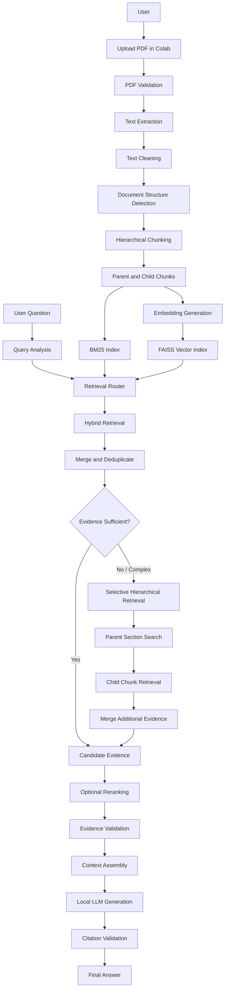

# Agentic RAG — Intelligent PDF Question Answering System

<p align="center">
  <strong>An Adaptive, Local-LLM-Powered Agentic RAG System for PDF Documents</strong>
</p>

<p align="center">
  
  
  
  
  
</p>

<p align="center">
  <a href="https://colab.research.google.com/github/OWNER/REPOSITORY/blob/main/Agentic_RAG_Chatbot.ipynb">
    
  </a>
</p>

---

## 1. Project Overview

**Agentic RAG** is an intelligent PDF question-answering system that uses Retrieval-Augmented Generation (RAG), hybrid information retrieval, and locally running Large Language Models (LLMs).

The project is designed primarily for **Google Colab Free GPU runtime**. Users can open the notebook directly in Google Colab, upload their own PDF documents, and ask questions about their contents without requiring a locally installed LLM or a paid hosted LLM API.

Unlike conventional PDF chatbots that rely on a single retrieval method, this system combines:

- **BM25:** Keyword-based information retrieval.
- **FAISS:** Semantic similarity search using vector embeddings.
- **Selective Hierarchical Retrieval:** Conditional retrieval from broader document sections when the initial results are insufficient.
- **Local LLM:** Evidence-grounded answer generation.

The system first performs hybrid retrieval. If the retrieved evidence is insufficient or the question requires broader contextual understanding, it selectively investigates relevant document sections and retrieves additional passages.

The final response is generated using a local LLM and is intended to include references to the supporting PDF pages.

### Core Idea

> Retrieve intelligently, investigate selectively, and generate answers grounded in the uploaded document.

---

## 2. Problem Statement

Conventional PDF question-answering systems can encounter several limitations:

- Keyword-based retrieval may miss relevant information when the wording differs.
- Semantic retrieval may overlook exact technical terms and identifiers.
- Fixed-size chunking can separate related information.
- Complex questions may require information from multiple document sections.
- Initial retrieval results may not provide enough evidence to answer a complete question.
- LLMs may generate unsupported information when the retrieved context is incomplete.
- Hosted LLM APIs can introduce cost, privacy, and connectivity constraints.

This project addresses these challenges through hybrid retrieval, adaptive retrieval routing, selective hierarchical search, and evidence-grounded generation.

---

## 3. Project Objectives

1. Build a chatbot that can process user-uploaded PDF documents.
2. Extract document content while preserving page-level information.
3. Organize document content using hierarchical chunking.
4. Implement BM25 keyword retrieval and FAISS semantic retrieval.
5. Combine both methods into a hybrid retrieval pipeline.
6. Introduce query analysis and conditional hierarchical retrieval.
7. Generate answers using a locally running LLM.
8. Provide traceable PDF page references.
9. Handle questions for which the document contains insufficient evidence.
10. Optimize the complete workflow for Google Colab's limited GPU and RAM resources.
11. Provide a reproducible notebook that can be executed directly from GitHub in Google Colab.

---

## 4. Key Features

| Feature | Description |
|---|---|
| Google Colab Execution | Run the entire project through a Google Colab notebook. |
| PDF Upload | Upload different PDF documents directly through the notebook. |
| Text Extraction | Extract text and page-level information. |
| OCR Support | Optional OCR for scanned PDFs. |
| Hierarchical Chunking | Organize content into parent sections and child chunks. |
| BM25 Retrieval | Retrieve passages using keyword relevance. |
| FAISS Semantic Search | Retrieve passages using vector similarity. |
| Hybrid Retrieval | Combine keyword and semantic retrieval results. |
| Query Analysis | Analyze questions before selecting the retrieval strategy. |
| Selective Hierarchical Retrieval | Investigate broader document sections when necessary. |
| Optional Reranking | Improve the ordering of retrieved passages. |
| Local LLM | Generate answers using a locally running model. |
| Page Citations | Provide references to supporting PDF pages. |
| Evidence-Based Answers | Reduce unsupported responses through evidence-grounded generation. |
| Insufficient Evidence Handling | Communicate when the document does not contain enough information. |

*The final notebook and its tested implementation determine which optional features are available.*

---

## 5. System Architecture

The system follows a multi-stage document-processing, retrieval, and generation pipeline.

### High-Level Architecture



### Main Architecture Layers

**1. Document Processing Layer**

Validates uploaded PDFs, extracts text, cleans content, identifies available structure, and generates hierarchical chunks.

**2. Indexing Layer**

Creates BM25 and FAISS indexes for keyword and semantic retrieval.

**3. Query Processing Layer**

Analyzes user questions and selects the appropriate retrieval path.

**4. Adaptive Retrieval Layer**

Performs initial hybrid retrieval and selectively escalates to hierarchical retrieval when needed.

**5. Evidence Processing Layer**

Merges, deduplicates, optionally reranks, and validates retrieved passages.

**6. Generation Layer**

Uses a locally running LLM to generate answers from retrieved document evidence.

**7. Response Layer**

Validates citations and displays the final answer or an insufficient-evidence response.

---

## 6. Retrieval Strategy

### Selected Architecture: Approach 1 + Selective Approach 2

#### Approach 1 — Hybrid Retrieval

Hybrid retrieval combines two complementary search techniques.

**BM25 Keyword Retrieval**

- Identifies exact words and phrases.
- Works well with technical terminology, names, identifiers, and specific terms.
- Retrieves passages based on keyword relevance.

**FAISS Semantic Retrieval**

- Uses embeddings to represent document chunks as vectors.
- Finds semantically related passages.
- Helps when the wording of the question differs from the document.

**Combined Retrieval Workflow**

```text
              User Question
                    |
          +---------+---------+
          |                   |
          v                   v
      BM25 Search         FAISS Search
          |                   |
          v                   v
     Keyword Results    Semantic Results
          |                   |
          +---------+---------+
                    |
                    v
               Result Fusion
                    |
                    v
               Deduplication
                    |
                    v
             Hybrid Results
```

#### Selective Approach 2 — Hierarchical Retrieval

Hierarchical retrieval is used conditionally rather than for every question.

It is triggered when:

- Initial retrieval results are insufficient.
- The question contains multiple parts.
- Relevant information may exist across different sections.
- The document has a complex structure.
- More contextual evidence is required.

**Workflow**

1. Identify relevant parent sections.
2. Search within those sections.
3. Retrieve focused child chunks.
4. Merge additional candidates with the initial results.
5. Deduplicate and reassess evidence coverage.

This design avoids unnecessary retrieval operations while supporting more complex questions.

---

## 7. End-to-End Workflow

| Stage | Process | Description |
|---|---|---|
| 1 | Colab Runtime Setup | Detect GPU and configure the execution environment. |
| 2 | Dependency Installation | Install required Python and system dependencies. |
| 3 | Model Initialization | Download and load the required local models. |
| 4 | PDF Upload | Upload and validate the document. |
| 5 | Text Extraction | Extract text and page information. |
| 6 | Text Cleaning | Normalize extracted content. |
| 7 | Structure Detection | Identify available headings and sections. |
| 8 | Hierarchical Chunking | Generate parent and child chunks. |
| 9 | BM25 Indexing | Build the keyword retrieval index. |
| 10 | Embedding Generation | Convert chunks into vectors. |
| 11 | FAISS Indexing | Build the semantic retrieval index. |
| 12 | Query Analysis | Analyze the user's question. |
| 13 | Hybrid Retrieval | Retrieve evidence using BM25 and FAISS. |
| 14 | Evidence Assessment | Check whether initial results are sufficient. |
| 15 | Hierarchical Retrieval | Search relevant sections when necessary. |
| 16 | Reranking | Optionally improve candidate ranking. |
| 17 | Evidence Validation | Validate retrieved passages. |
| 18 | Context Assembly | Prepare evidence for the local LLM. |
| 19 | Answer Generation | Generate a response locally. |
| 20 | Citation Validation | Verify references against PDF metadata. |
| 21 | Response Display | Display the answer and page references. |

---

## 8. Technology Stack

The following is the proposed technology stack. Exact versions and final model choices should be updated to match the working notebook.

| Category | Technology | Purpose |
|---|---|---|
| Language | Python | Core implementation |
| Execution | Google Colab | Cloud notebook and GPU runtime |
| PDF Extraction | PyMuPDF | Extract PDF text |
| Additional PDF Processing | pdfplumber | Layout-oriented extraction |
| OCR | Tesseract / pytesseract | Scanned PDF processing |
| Keyword Retrieval | rank_bm25 | BM25 search |
| Embeddings | BAAI/bge-small-en-v1.5 | Text embeddings |
| Vector Search | FAISS | Semantic similarity search |
| Main LLM | Qwen2.5-3B-Instruct | Proposed local answer-generation model |
| Lightweight LLM | Qwen2.5-1.5B-Instruct GGUF | Alternative local model |
| Reranking | FlagEmbedding / BGE Reranker | Optional reranking |
| Model Runtime | llama.cpp | Local GGUF inference |
| User Interface | Gradio | Interactive interface |

### Proposed Model Configuration

| Model | Role |
|---|---|
| BAAI/bge-small-en-v1.5 | Document and query embeddings |
| Qwen2.5-3B-Instruct (4-bit) | Main proposed answer-generation model |
| Qwen2.5-1.5B-Instruct GGUF Q4_K_M | Lightweight alternative |
| BGE Reranker | Optional candidate reranking |
| Local NLI Model | Optional evidence verification |

These are proposed choices, not claims that all models have already been tested together.

---

## 9. Google Colab Hardware Requirements

The project is designed to run using Google Colab's free GPU runtime.

### Target Configuration

| Component | Target |
|---|---|
| Platform | Google Colab Free |
| GPU | NVIDIA Tesla T4 (target) |
| GPU Memory | 16 GB VRAM |
| System RAM | Approximately 12–16 GB |
| Acceleration | CUDA, when available |
| Execution | Jupyter Notebook |

**Hardware availability note:** Google Colab does not guarantee a specific GPU or uninterrupted GPU access. The notebook should detect the available hardware dynamically and adjust the model configuration.

### Resource Optimization

- Use 4-bit quantization for the proposed main LLM.
- Perform PDF extraction on CPU.
- Run BM25 on CPU.
- Use FAISS CPU indexing where appropriate.
- Use GPU for embeddings, reranking, and generation when beneficial.
- Use smaller processing batches.
- Load large models sequentially when possible.
- Release unused GPU memory.
- Provide a practical fallback when GPU access is unavailable.

---

## 10. Running the Project on Google Colab

**No local Python environment or local GPU setup is required for the intended Colab workflow.**

### Step 1 — Open the Notebook

Click the button below:

[](https://colab.research.google.com/github/OWNER/REPOSITORY/blob/main/Agentic_RAG_Chatbot.ipynb)

Alternatively, open the notebook from the repository in Google Colab.

### Step 2 — Enable GPU Runtime

In Google Colab:

1. Open **Runtime**.
2. Select **Change runtime type**.
3. Choose **GPU** under Hardware accelerator, if available.
4. Click **Save**.

### Step 3 — Run the Setup Cells

Execute the notebook from the beginning.

The setup cells should:

- Install the required dependencies.
- Configure the runtime.
- Detect available hardware.
- Download the required models.
- Initialize the retrieval and generation components.
- Run smoke tests.

No separate local dependency installation should be necessary.

### Step 4 — Upload a PDF

Use the PDF upload component provided in the notebook.

The system will validate and process the document.

### Step 5 — Process and Index the Document

The notebook will:

- Extract PDF text.
- Clean and normalize the content.
- Generate hierarchical chunks.
- Build the BM25 index.
- Generate embeddings.
- Build the FAISS index.

### Step 6 — Ask Questions

Enter a question about the uploaded PDF.

The system will perform hybrid retrieval and assess whether more evidence is required.

### Step 7 — View the Answer

The local LLM will generate a response based on retrieved evidence.

The output should include supporting PDF page references where available.

---

## 11. Dependencies

The notebook should install the dependencies directly inside Google Colab.

The planned Python dependency list includes:

```text
pymupdf
pdfplumber
rank_bm25
faiss-cpu
sentence-transformers
FlagEmbedding
huggingface_hub
gradio
pytesseract
llama-cpp-python
```

Additional system dependency, if OCR is enabled:

```text
Tesseract OCR
```

The notebook should use compatible package versions and install only the components required by the final implementation.

**Important:** `llama-cpp-python` and CUDA builds must match the actual Colab runtime. The notebook should verify successful installation and model loading instead of assuming a particular CUDA build will work in every session.

---

## 12. Evaluation and Benchmarking

The system should be evaluated across retrieval quality, answer quality, citation correctness, and computational performance.

### Retrieval Metrics

| Metric | Description |
|---|---|
| Recall@5 | Measures whether relevant evidence appears in the top five results. |
| Recall@10 | Measures whether relevant evidence appears in the top ten results. |
| MRR | Measures the ranking position of the first relevant result. |
| nDCG@10 | Measures the quality of ranking relevant results. |

### Answer Evaluation

- Answer correctness.
- Answer relevance.
- Evidence faithfulness.
- Citation correctness.
- Handling of multi-part questions.
- Correct abstention when evidence is missing.

### Performance Evaluation

- PDF processing time.
- Index creation time.
- Retrieval latency.
- LLM generation latency.
- Total response time.
- GPU memory consumption.
- System RAM consumption.

### Comparative Experiments

| Experiment | Configuration |
|---|---|
| 1 | BM25-only retrieval |
| 2 | FAISS-only retrieval |
| 3 | Hybrid BM25 + FAISS retrieval |
| 4 | Hybrid + selective hierarchical retrieval |
| 5 | Hybrid + optional reranking |
| 6 | Hybrid + optional evidence verification |

Only report results from experiments actually executed in Google Colab.

---

## 13. Reliability and Error Handling

The system should account for:

- Invalid or corrupted PDFs.
- Password-protected documents.
- Scanned PDFs.
- Documents with no extractable text.
- Large PDF documents.
- Empty questions.
- Missing retrieval evidence.
- Conflicting passages.
- Model download failures.
- GPU unavailability.
- Insufficient VRAM.
- Optional component failures.

When the PDF does not provide enough information, the system should clearly communicate that limitation instead of inventing an answer.

---

## 14. Privacy and Local Inference

The answer-generation model is intended to execute locally within the Google Colab runtime rather than through a hosted LLM inference API.

This reduces dependence on external model inference services.

However, Google Colab is a cloud-hosted execution environment, not a local computer. Users should consider the sensitivity of their documents before uploading them.

Model downloads require internet connectivity. Any other external data transmission should be clearly documented.

---

## 15. Project Structure

```text
Agentic-RAG/
│
├── Agentic_RAG_Chatbot.ipynb
│
├── diagrams/
│   └── workflow.png
│
├── README.md
│
└── requirements.txt
```

An optional separate setup notebook may be included:

```text
├── Stage0_Setup.ipynb
```

### Repository Files

| File | Description |
|---|---|
| `Agentic_RAG_Chatbot.ipynb` | Main Colab notebook containing the complete pipeline. |
| `Stage0_Setup.ipynb` | Optional separate environment setup notebook. |
| `diagrams/workflow.png` | Architecture and workflow diagram. |
| `README.md` | Project documentation. |
| `requirements.txt` | Dependencies used by the notebook. |

---

## 16. Future Improvements

Potential future enhancements include:

- Improved OCR and multilingual document support.
- More accurate table and image extraction.
- Better document structure detection.
- Adaptive chunk sizes and retrieval thresholds.
- More advanced query classification.
- Improved citation verification.
- Cross-document retrieval.
- Conversation memory for follow-up questions.
- Retrieval caching.
- Optional evidence graphs.
- More comprehensive testing on different document types.

These are future extensions and should not be represented as completed functionality until implemented.

---

## 17. Development Status

Update this section as the notebook is developed and tested.

| Component | Status |
|---|---|
| Project architecture | Defined |
| Colab runtime setup | To be implemented / verified |
| PDF upload | To be implemented / verified |
| PDF extraction | To be implemented / verified |
| Text cleaning | To be implemented / verified |
| Hierarchical chunking | To be implemented / verified |
| BM25 indexing | To be implemented / verified |
| Embedding generation | To be implemented / verified |
| FAISS indexing | To be implemented / verified |
| Hybrid retrieval | To be implemented / verified |
| Selective hierarchical retrieval | To be implemented / verified |
| Reranking | Optional |
| Evidence verification | Optional |
| Local LLM generation | To be implemented / verified |
| Citation validation | To be implemented / verified |
| Gradio interface | To be implemented / verified |
| Benchmarking | Pending evaluation |

---

## 18. References and Resources

- [Google Colab](https://colab.research.google.com/)
- [PyMuPDF Documentation](https://pymupdf.readthedocs.io/)
- [FAISS GitHub Repository](https://github.com/facebookresearch/faiss)
- [Sentence Transformers](https://sbert.net/)
- [Hugging Face Model Hub](https://huggingface.co/models)
- [Qwen Models](https://huggingface.co/Qwen)
- [BAAI Models](https://huggingface.co/BAAI)
- [Gradio Documentation](https://www.gradio.app/docs)
- [llama.cpp](https://github.com/ggml-org/llama.cpp)

---

## 19. Contributing

Contributions and suggestions are welcome.

1. Fork the repository.
2. Create a feature branch.
3. Make your changes.
4. Test the notebook in Google Colab.
5. Submit a pull request describing your improvements.

Contributions should preserve the project's local inference requirement and resource-conscious architecture unless a change is explicitly proposed and documented.

---

## 20. License

Add an appropriate open-source license before publishing the project.

The repository's license should also be compatible with the licenses of the models and dependencies used.

---

## Project Summary

**Agentic RAG** is designed as a resource-conscious, adaptive PDF question-answering system that runs through Google Colab.

It combines BM25 keyword retrieval and FAISS semantic search, with selective hierarchical retrieval for complex queries and insufficient initial evidence.

The retrieved passages are supplied to a locally running LLM, which generates answers grounded in document content and supported by PDF page references.

The primary goal is to provide an accessible, reproducible, and open-source Agentic RAG implementation that can process different PDF documents within the limitations of Google Colab's free GPU environment.

---

<p align="center">
  <strong>Built with Python · Hybrid Retrieval · Local LLMs · Google Colab</strong>
</p>
